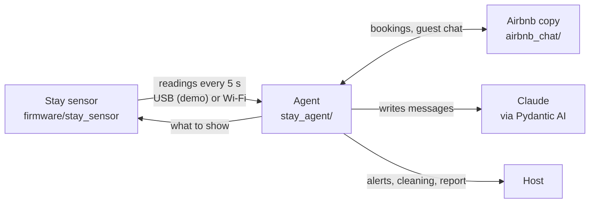

# Stay Sensor

**Your rental, watched while you're away.** A small sensor in the apartment plus an AI
agent that protects Airbnb hosts from noise, parties and guests who don't follow the
house rules, without the host having to watch or write a single message.

- **The sensor** sits in the living room and measures sound level (decibels only, no
  audio is recorded), temperature and humidity. It notices when it is moved, and
  flashes DO NOT TOUCH when a hand comes close.
- **The agent** reads the sensor, compares it with the booking and the house rules,
  and acts as the host in the Airbnb chat: a polite note to the guest the first time,
  a final warning and an alert to the host the second time. It also answers whatever
  the guest writes, as the host.
- **After checkout** it orders cleaning and writes the host a stay report and a draft
  review of the guest.

Built at a hackathon on the [Atech](https://atech.dev) modular ESP32-S3 kit. The pitch
is in [docs/Presentation.pptx](docs/Presentation.pptx).

## How it works



**Code decides, Claude writes.** Whether a reading is a problem, when to warn, and when
to call the host are fixed rules in code. Claude only writes the words: warnings,
replies to the guest, the host's alerts, the report and the review. If Claude can't be
reached, a template message goes out instead.

Airbnb only lets approved partners send guest messages through its API, so the demo
uses [`airbnb_chat/`](airbnb_chat), a lookalike of the Airbnb inbox with an API the
agent reads and writes.

## Run the demo

Needs Python 3.10+, the board on a USB-C **data** cable, and a Claude API key.

```bash
# 1. The Airbnb copy: http://127.0.0.1:8766/hosting/messages
pip install -r airbnb_chat/requirements.txt
python -m airbnb_chat

# 2. Make Simen the host of Emma's stay at "Cozy loft near Bryggen" (local data only)
curl -X PATCH localhost:8766/api/conversations/1 -H 'Content-Type: application/json' -d '{"host": {"name": "Simen"}}'

# 3. Flash the sensor (the first build downloads the ESP32 compiler, about 2.4 GB)
pip install atech
atech upload firmware/stay_sensor

# 4. The agent, talking to the board over USB
pip install -e "./stay_agent[device]"
cd stay_agent && cp .env.example .env      # put your Claude API key in .env (git-ignored)
stay-agent serve --config config.demo.json --usb
```

The board shows "Welcome Emma! All good." Then:

- **Noise above 90 dB for 3 s:** Simen sends Emma a friendly note, and the board turns amber.
- **A second time:** a final warning to Emma, an alert to the host, and the board pulses red.
- **Emma writes in the chat:** Simen answers within seconds, from the booking, the house
  rules and the apartment facts in `config.demo.json` (placeholders: replace them).
- **Move the sensor or reach for it:** MOVED or DO NOT TOUCH on the screen at once.

Without the board: `stay-agent simulate party --config config.demo.json` plays a whole
night into the Airbnb copy in seconds.

## Status

| Part | State |
| --- | --- |
| Sensor over USB | Working: noise, temperature, humidity, tamper, DO NOT TOUCH |
| Agent | Working with Claude: warnings, escalation on the second one, answers to the guest, owner alerts, report and review draft. 16 tests |
| Airbnb copy | Working: the agent reads stays and writes as the host |
| Sensor over Wi-Fi | Built (the sensor posts to the agent, so it also works with the agent in the cloud), not working on a real network yet: the venue's guest Wi-Fi blocks devices from reaching each other |
| CO₂ (people count) and smoke | In the pitch, not in the hardware: the kit we had has no CO₂ or smoke sensor |
| Real Airbnb | Needs Airbnb partner access, or a property-management tool that has it |

## Repository layout

| Path | What it is |
| --- | --- |
| [`firmware/stay_sensor/`](firmware/stay_sensor) | The sensor: Atech project and [its interface](firmware/stay_sensor/PROTOCOL.md) |
| [`stay_agent/`](stay_agent) | The agent: rules, Claude via Pydantic AI, USB and Wi-Fi, simulator. [README](stay_agent/README.md) |
| [`airbnb_chat/`](airbnb_chat) | The Airbnb copy: host and guest inbox with an API. [Docs](docs/airbnb-chat.md) |
| [`docs/Presentation.pptx`](docs/Presentation.pptx) | The pitch |

Earlier ideas from the same hackathon, kept for reference:

| Path | What it is |
| --- | --- |
| [`firmware/controller/`](firmware/controller), [`bridge/`](bridge) | Agent Controller: a desk device to watch and approve AI coding agents. [Idea](docs/idea.md), [architecture](docs/architecture.md), [hardware](docs/hardware.md) |
| [`room/`](room) | Room: answers questions from a meeting while it runs (Norwegian). [README](room/README.md) |
