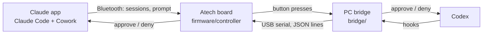

# Agent Controller

A physical controller that sits next to your keyboard and shows what every AI coding agent is doing, so you can keep working on your PC without switching into the agent's window or terminal.

- **See status at a glance.** One light per session: working, done, or red because it needs you.
- **Answer without switching windows.** Approve or deny from buttons on the device, after reading what the agent wants on its screen.
- **One device for every agent.** Claude Code and Codex first, more later.

The first prototype is built on the [Atech](https://atech.dev) modular ESP32-S3 kit.

## Why this, and not what already exists

OpenAI's Codex Micro (USD 230) is a desk controller for Codex only. Anthropic's Hardware Buddy API and Atech's own Clawd demo cover Claude only. Status lights such as LumoCue and Signal One support several agents but only show colours. No physical controller we found covers several agents **and** lets you act. That gap is the product. Details in [docs/idea.md](docs/idea.md).

What has to set it apart:

1. **Priority, not just lights:** a queue of what needs you first, across agents.
2. **Safe approval:** the screen shows what will be approved and how risky it is. Risky requests are sent back to the PC.
3. **One press to the right session** when you need to look yourself.

## How it works



Two paths into the same device. The **Claude desktop app** talks to the board directly over Bluetooth, using Anthropic's Hardware Buddy protocol. **Other agents** such as Codex report through their hooks to the bridge, which drives the board over USB. The screen always shows the session that needs you most. Neither path goes through a cloud service. Full design and message protocol in [docs/architecture.md](docs/architecture.md).

## Repository layout

| Path | What it is |
| --- | --- |
| [`firmware/controller/`](firmware/controller) | Atech project for the board: modules and ports in `project.yaml` |
| [`bridge/`](bridge) | Python program on the PC: collects agent events, drives the board |
| [`docs/idea.md`](docs/idea.md) | Problem, target users, competitors, positioning |
| [`docs/hardware.md`](docs/hardware.md) | Kit, modules, port layout, open questions |
| [`docs/architecture.md`](docs/architecture.md) | Data flow, session states, board protocol |

## Getting started

Needs Python 3.10+, a USB-C **data** cable and the board.

```bash
pip install atech

# 1. Check the planned layout against the board in your hand
atech view firmware/controller        # opens the board in 3D in your browser

# 2. Flash it (the first build downloads the ESP32 compiler, about 2.4 GB, once)
atech validate firmware/controller
atech upload firmware/controller
atech check                            # which modules answered

# 3. Talk to it by hand before the bridge exists
atech monitor                          # press approve/deny, watch the events
atech send status_pixel '{"index": 0, "r": 255, "g": 0, "b": 0}'
atech send speaker_play_rtttl "chirp:d=16,o=6,b=180:c,e,g"
atech send show_session '{"agent": "Codex", "project": "demo", "state": "needs_input", "summary": "Run: npm test", "pos": 1, "total": 2}'
```

## Status

| Part | State |
| --- | --- |
| Firmware over USB | Flashed and working: screen, light grid, speaker and buttons respond to manual commands |
| Claude app over Bluetooth | Tested: shows Claude sessions and alerts when one waits. The app only sometimes sends an answerable prompt, so approving over Bluetooth is unreliable. Link not encrypted yet |
| Bridge + Claude Code hooks | Built and tested end to end with a fake board. Approves any Claude Code permission request from the buttons. Not yet run on the Mac |
| Knob | Built (firmware v0.8, bridge 0.0.2), tested with a fake board: turn to move through waiting requests, buttons answer the one shown |
| Codex integration | Researched: `PermissionRequest` hook waits for an answer. Not built |

### Flashing a prebuilt image

`atech upload` builds from source and downloads the ESP32 compiler (2.4 GB) the first time. To flash a prebuilt image instead:

```bash
pip install esptool
esptool --chip esp32s3 --before default-reset --after hard-reset write-flash 0x0 agent-controller-v0.3.bin
```

### Connecting the Claude app

1. Claude app: **Help → Troubleshooting → Enable Developer Mode**.
2. **Developer → Open Hardware Buddy…** → **Connect** → pick `Claude-AC…`. Allow Bluetooth when macOS asks.
3. The idle screen says "Claude app: connected". When a Claude Code or Cowork session asks for permission, the screen shows it: left button approves, right button denies.

Open questions are tracked in [docs/hardware.md](docs/hardware.md#open-questions).
