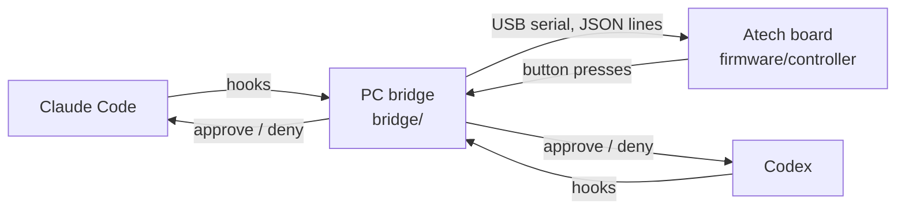

# Agent Controller

A physical controller that sits next to your keyboard and shows what every AI coding agent is doing, so you can keep working on your PC without switching into the agent's window or terminal.

- **See status at a glance.** One light per session: working, done, or red because it needs you.
- **Answer without switching windows.** Approve or deny from buttons on the device, after reading what the agent wants on its screen.
- **One device for every agent.** Claude Code and Codex first, more later.

The first prototype is built on the [Atech](https://atech.dev) modular ESP32-S3 kit.

## Why this, and not what already exists

OpenAI's Codex Micro (USD 230) is a desk controller for Codex only. Anthropic's Hardware Buddy API and Atech's own Clawd demo cover Claude only. Status lights such as LumoCue and Signal One support several agents but only show colours. No physical controller we found covers several agents **and** lets you act. That gap is the product. Details in [docs/idea.md](docs/idea.md).

What has to set it apart:

1. **Priority, not just lights:** a queue of what needs you first, across agents.
2. **Safe approval:** the screen shows what will be approved and how risky it is. Risky requests are sent back to the PC.
3. **One press to the right session** when you need to look yourself.

## How it works



The agents report events through their hook systems. The bridge turns them into one session list, decides what matters most, and drives the board over USB. The board stays local: no cloud gateway sits between your agents and the device. Full design and message protocol in [docs/architecture.md](docs/architecture.md).

## Repository layout

| Path | What it is |
| --- | --- |
| [`firmware/controller/`](firmware/controller) | Atech project for the board: modules and ports in `project.yaml` |
| [`bridge/`](bridge) | Python program on the PC: collects agent events, drives the board |
| [`docs/idea.md`](docs/idea.md) | Problem, target users, competitors, positioning |
| [`docs/hardware.md`](docs/hardware.md) | Kit, modules, port layout, open questions |
| [`docs/architecture.md`](docs/architecture.md) | Data flow, session states, board protocol |

## Getting started

Needs Python 3.10+, a USB-C **data** cable and the board.

```bash
pip install atech

# 1. Check the planned layout against the board in your hand
atech view firmware/controller        # opens the board in 3D in your browser

# 2. Flash it (the first build downloads the ESP32 compiler, about 2.4 GB, once)
atech validate firmware/controller
atech upload firmware/controller
atech check                            # which modules answered

# 3. Talk to it by hand before the bridge exists
atech monitor                          # press approve/deny, watch the events
atech send status_pixel '{"index": 0, "r": 255, "g": 0, "b": 0}'
atech send speaker_play_rtttl "chirp:d=16,o=6,b=180:c,e,g"
atech send show_session '{"agent": "Codex", "project": "demo", "state": "needs_input", "summary": "Run: npm test", "pos": 1, "total": 2}'
```

## Status

| Part | State |
| --- | --- |
| Firmware | Compiles. Screen shows agent, project, state and request. Not yet flashed or tested on the board |
| Bridge | Session model, queue ranking and screen payload, tested. Hook listener and board driver not written |
| Approving from the device | Researched: both agents have a `PermissionRequest` hook that waits for an answer. Not built |
| Claude Code integration | Not started |
| Codex integration | Not started |

Open questions are tracked in [docs/hardware.md](docs/hardware.md#open-questions).
