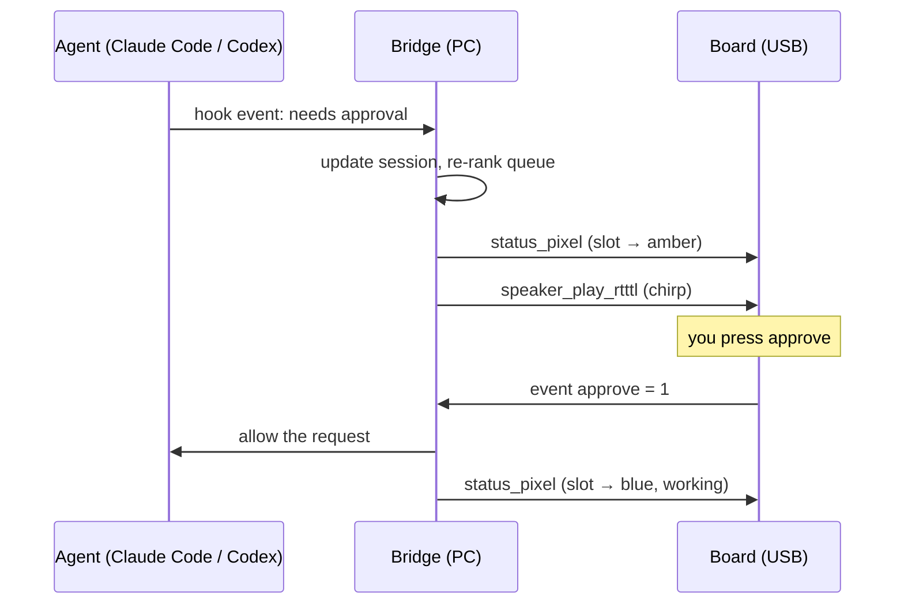

# Architecture

Three parts: the agents report events, the bridge on the PC keeps one combined session list, and the board shows it and sends back button presses.

## 1. Agents → bridge

Each agent calls a small command on every hook event. The command forwards the event to the bridge and exits at once. **A hook must never break the agent:** if the bridge is down, the hook still exits cleanly.

Which hook means what, per the [dev.to write-up of Agent Needs You](https://dev.to/icegaming/i-gave-my-ai-coding-agents-a-face-so-they-stop-waiting-on-me-265o). Check against the current Claude Code and Codex docs before relying on it.

| Session state | Claude Code | Codex |
| --- | --- | --- |
| `working` | `UserPromptSubmit`, `PostToolUse` | `UserPromptSubmit`, `PostToolUse` |
| `needs_input` | `Notification` | `PermissionRequest` |
| `done` | `Stop` | `Stop` |
| added / removed | `SessionStart` / `SessionEnd` | `SessionStart` / `SessionEnd` |

**Open question:** approving from the device needs a hook that can *wait* for the answer and return allow/deny, not just report. Find out which hook does that in each agent before building the approve flow.

## 2. Bridge

Python, in [`bridge/`](../bridge). It:

1. Receives normalised events (`AgentEvent` in [`events.py`](../bridge/src/agent_controller/events.py)).
2. Keeps one `Session` per agent session, with its state and the pending request.
3. Ranks the queue: what needs you first, oldest first (`rank_queue`).
4. Assigns each session one of the 9 light-grid slots and pushes changes to the board.
5. Maps button presses back to the selected session.

## 3. Bridge ↔ board

USB serial, 115200 baud, one JSON object per line. The bridge uses the Atech Python SDK (`atech.Board`), which wraps this and waits for the board to confirm each action.

### Actions the bridge sends (built into the v0 firmware)

| Action | Value | Use |
| --- | --- | --- |
| `status_pixel` | `{"index": 0-8, "r", "g", "b"}` | Set one session's light |
| `status_fill` | `{"r", "g", "b"}` | All lights, e.g. at startup |
| `status_clear` | none | All lights off |
| `speaker_play_rtttl` | RTTTL string | Chirp when a session needs you |
| `speaker_set_volume` | 0.0–1.0 | Volume |
| `speaker_stop` | none | Silence |

### Events the board sends

| Event | Value | Use |
| --- | --- | --- |
| `approve` | 1 on press, 0 on release | Approve the selected request |
| `deny` | 1 on press, 0 on release | Deny the selected request |
| `mic_level` | 0–32767 every 250 ms | Voice activity, later |

### Planned custom actions (need firmware code)

The screen has no built-in actions, so showing a request needs a few lines in `project.yaml`'s `code:` block, handled through `atech_action`:

| Action | Value | Shows |
| --- | --- | --- |
| `show_request` | `{"agent", "summary", "risk"}` | The selected request and its risk on the screen |
| `clear_request` | none | Idle screen |

## Session states and colours

| State | Light | Meaning |
| --- | --- | --- |
| `needs_input` | amber | Waiting for you: approval or a question |
| `error` | red | Failed, look at it |
| `done` | green | Finished, result unread |
| `working` | blue | Busy, ignore |
| `idle` | off | Nothing happening |

Ranked in that order: what needs you comes first. Colours match Codex Micro's state language ([RohitAI](https://rohitai.com/blog/openai-codex-micro-agent-control-surface)), except idle, which is off instead of white. Users of both read them the same way.
