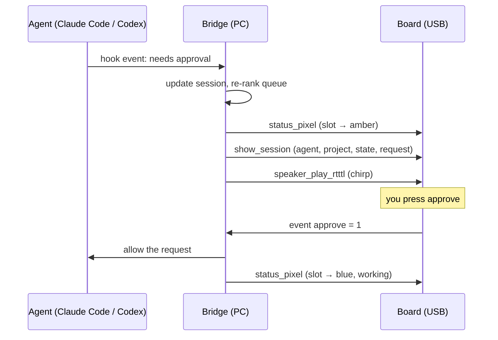

# Architecture

Three parts: the agents report events, the bridge on the PC keeps one combined session list, and the board shows it and sends back button presses.



## 1. Agents → bridge

Each agent calls a small command on every hook event. The command forwards the event to the bridge and exits at once. **A hook must never break the agent:** if the bridge is down, the hook still exits cleanly.

Which hook means what. Sources: [Claude Code hooks reference](https://code.claude.com/docs/en/hooks), [Pushary on Codex hooks](https://pushary.com/codex-hooks), [dev.to write-up of Agent Needs You](https://dev.to/icegaming/i-gave-my-ai-coding-agents-a-face-so-they-stop-waiting-on-me-265o).

| Session state | Claude Code | Codex |
| --- | --- | --- |
| `working` | `UserPromptSubmit`, `PostToolUse` | `UserPromptSubmit`, `PostToolUse` |
| `needs_input` | `PermissionRequest` | `PermissionRequest` |
| `done` | `Stop` | `Stop` |
| added / removed | `SessionStart` / `SessionEnd` | `SessionStart` / `SessionEnd` |

Use `PermissionRequest`, not `Notification`, for Claude Code: its `permission_prompt` notification only fires after the prompt has waited about six seconds.

## Approving from the device

Both agents have a `PermissionRequest` hook that **waits** for an answer, so a button press can approve or deny. The design:

1. The agent is about to ask for permission and runs our hook command.
2. The hook sends the request to the bridge on localhost and waits.
3. The bridge shows it on the screen (`show_session`, state `needs_input`) and chirps.
4. A press on `approve` or `deny` comes back as an event. The bridge answers the waiting hook.
5. The hook prints the decision and exits. **No press within the time limit, or the bridge is down: the hook prints nothing and exits 0**, and the agent falls back to its normal prompt. The device can never approve by default.

### Claude Code

- **When:** `PermissionRequest` runs when Claude Code is about to ask you for permission. `PreToolUse` runs before every tool call and is not the right moment.
- **Input on stdin:** `session_id`, `cwd`, `permission_mode`, `tool_name` and `tool_input`. For Bash, `tool_input` holds `command` and `description`, which is what the screen should show.
- **Approve:** `{"hookSpecificOutput": {"hookEventName": "PermissionRequest", "decision": {"behavior": "allow"}}}`
- **Deny:** same, with `"behavior": "deny"` and a `"message"` that tells Claude why.
- **No decision:** the normal permission flow continues. Deny rules in settings still win over a hook's `allow`.
- **Time limit:** command hooks default to 600 seconds. Set `timeout` on the hook entry to something shorter.
- **To test:** whether the terminal also shows its own prompt while the hook is waiting. One third-party reference says the dialog appears if the hook takes more than 1–2 seconds ([dippy](https://github.com/ldayton/dippy/blob/2edad4a48d616a191c83417552ddc60eb79b526a/docs/hook-systems/claude-code-hooks.md)). If so, answering on either side must not answer twice.

### Codex

- **When:** `PermissionRequest` fires when Codex escalates an action it will not run on its own, such as leaving the sandbox or using the network. It does not fire for every tool call.
- **Config:** `~/.codex/hooks.json`. Codex only runs a hook it trusts: a hash in `~/.codex/config.toml` must match, otherwise the hook is silently skipped.
- **Answer:** allow or deny settles the request and skips Codex's auto-reviewer. No answer falls through to the reviewer or the normal prompt. Default time limit 600 seconds.
- **To verify:** the exact output JSON. Sources disagree between `hookSpecificOutput.decision.behavior` ([agent-hooks-bridge](https://pivanov.github.io/agent-hooks-bridge/adapters/codex.html)) and a top-level `decision.behavior` ([Codex issue #55065](https://github.com/openai/codex/issues/55065)). Test against the installed Codex version.
- **Known bug:** pressing Esc while a `PermissionRequest` hook runs can leave the turn stuck ([Codex issue #55065](https://github.com/openai/codex/issues/55065)).

## 2. Bridge

Python, in [`bridge/`](../bridge). It:

1. Receives normalised events (`AgentEvent` in [`events.py`](../bridge/src/agent_controller/events.py)).
2. Keeps one `Session` per agent session, with its state and the pending request.
3. Ranks the queue: what needs you first, oldest first (`rank_queue`).
4. Assigns each session one of the 9 light-grid slots and pushes changes to the board.
5. Maps button presses back to the selected session.

## 3. Bridge ↔ board

USB serial, 115200 baud, one JSON object per line. The bridge uses the Atech Python SDK (`atech.Board`), which wraps this and waits for the board to confirm each action.

### Actions the bridge sends (built into the v0 firmware)

| Action | Value | Use |
| --- | --- | --- |
| `status_pixel` | `{"index": 0-8, "r", "g", "b"}` | Set one session's light |
| `status_fill` | `{"r", "g", "b"}` | All lights, e.g. at startup |
| `status_clear` | none | All lights off |
| `speaker_play_rtttl` | RTTTL string | Chirp when a session needs you |
| `speaker_set_volume` | 0.0–1.0 | Volume |
| `speaker_stop` | none | Silence |

### Events the board sends

| Event | Value | Use |
| --- | --- | --- |
| `approve` | 1 on press, 0 on release | Approve the selected request |
| `deny` | 1 on press, 0 on release | Deny the selected request |
| `mic_level` | 0–32767 every 250 ms | Voice activity, later |

### Screen actions (our own firmware code)

The screen has no built-in actions, so these live in the `code:` block of [`project.yaml`](../firmware/controller/project.yaml). The bridge builds the value with `screen_payload()` in [`events.py`](../bridge/src/agent_controller/events.py).

| Action | Value | Shows |
| --- | --- | --- |
| `show_session` | `{"agent", "project", "state", "summary", "pos", "total"}` | Which agent, which project, its state and what it wants |
| `clear_session` | none | Idle screen: "No agent needs you" |

What the 160×80 screen shows for one session:

```
+------------------------------------+
| Claude Code  2/3                   |  <- bar in the state's colour: which agent, place in queue
| NEEDS YOU                          |  <- state, large, same colour
| hackathon                          |  <- project (grey)
| Run: npm test                      |  <- what the agent wants, wrapped
| Left: approve   Right: deny        |  <- only when it needs you
+------------------------------------+
```

Text sent to the board must be ASCII. The screen font has no æøå, and the board's JSON reader does not decode `\u` escapes. `screen_payload()` folds text to ASCII and shortens the summary to 160 characters.

## Session states and colours

| State | Light | Meaning |
| --- | --- | --- |
| `needs_input` | amber | Waiting for you: approval or a question |
| `error` | red | Failed, look at it |
| `done` | green | Finished, result unread |
| `working` | blue | Busy, ignore |
| `idle` | off | Nothing happening |

Ranked in that order: what needs you comes first. Colours match Codex Micro's state language ([RohitAI](https://rohitai.com/blog/openai-codex-micro-agent-control-surface)), except idle, which is off instead of white. Users of both read them the same way.
