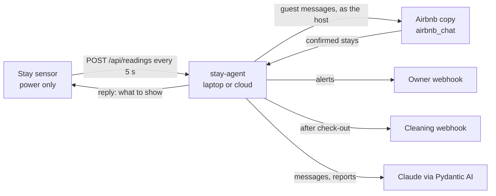

# stay-agent

The agent behind the Airbnb stay sensor. The device ([`firmware/stay_sensor`](../firmware/stay_sensor))
posts its readings over Wi-Fi; the agent decides what they mean, messages the guest,
escalates to the owner, orders cleaning after check-out and drafts the stay report and
the review of the guest.



**Code decides, Claude writes.** Whether a reading is a problem, when to remind and
when to call the owner are the host's rules, in plain code ([rules.py](src/stay_agent/rules.py),
[harness.py](src/stay_agent/harness.py)). Claude, through Pydantic AI with structured
output, writes the guest messages, owner alerts, the post-stay report and the review
draft ([llm.py](src/stay_agent/llm.py)). Every one of those falls back to a template if
Claude can't be reached or declines, so a guest always gets a message. The report's
numbers are computed by code; Claude only words them.

## Install

```bash
pip install -e "./stay_agent[dev]"          # Python 3.10+
cp .env.example .env                        # then put your Claude API key in stay_agent/.env (git-ignored)
```

## Try it without the device

A whole stay in seconds, one reading per simulated minute:

```bash
stay-agent simulate party        # loud 22:40-00:10: 3 messages, then the owner is contacted
stay-agent simulate all          # party, moved sensor, open window, long showers
stay-agent simulate quiet --no-claude
```

Each run prints the guest messages, owner alerts, the cleaning order, the stay report
and the review draft, and writes the report to `reports/<booking-id>.json`.

## Answering guests

When a guest writes in the Airbnb copy, the agent answers as the host (`owner_name`),
in the first person: Claude gets the chat, the booking, the house rules,
`property_info` and what the sensor reads now. What only the real host can handle
(refunds, damage, extra guests, emergencies) gets an "I'll get back to you" and an
alert to the owner. Put true facts in `property_info`: the agent tells guests what is
there and nothing else. Off with `"answer_guests": false`.

## Demo over USB (simplest)

```bash
python -m airbnb_chat                                    # http://127.0.0.1:8766/hosting/messages
cd stay_agent
stay-agent replica-stay --config config.demo.json --guest Anna
stay-agent serve --config config.demo.json --usb         # board on USB-C; close `atech monitor` first
```

The board sends its readings over USB and shows the agent's answers. `config.demo.json`
triggers on noise above 90 dB for 3 s (readings come every 5 s, so allow a few seconds),
and a moved or touched board is reported at once.

## Demo with the device on Wi-Fi and the Airbnb copy

Guests are messaged in the Airbnb copy on main ([`airbnb_chat/`](../airbnb_chat),
API in [docs/airbnb-chat.md](../docs/airbnb-chat.md)): the agent reads confirmed stays
from the host inbox and writes to the guest as the host, after a moment of "typing…".

```bash
pip install -r airbnb_chat/requirements.txt
python -m airbnb_chat                                   # http://127.0.0.1:8766/hosting/messages

cd stay_agent
stay-agent replica-stay --config config.demo.json --guest Anna      # a stay from today
stay-agent serve --config config.demo.json              # prints the URL the device should use
stay-agent setup-device --ssid "<wifi>" --password "<password>" \
    --server http://<printed-ip>:8080 --token change-me     # once, board on USB
```

Then unplug USB and power the board from a charger: it joins Wi-Fi and starts posting.
Keep `/hosting/messages` open: messages to the guest appear there live.
`config.demo.json` uses 30 s durations instead of 10-30 min, so clapping or playing
music near the sensor sends a message within a minute. The laptop and the board must be
on the same Wi-Fi (a phone hotspot works).

Without the device: `stay-agent simulate party --config config.demo.json` creates a
stay in the Airbnb copy and plays a whole night into it.

## In the cloud

Same program: run `stay-agent serve` on any host with a public HTTPS URL, set
`device_token`, and give the device that URL with `setup-device`. Nothing in the device
changes. Set `ANTHROPIC_API_KEY` in the host's environment.

## Settings

[`config.example.json`](config.example.json) lists everything: property and owner
name, house rules, limits (dB, °C, %RH and how long), the reminder and escalation
policy, and where things go. Leave `replica_url`, `owner_webhook` and
`cleaning_webhook` empty to print to the console instead.

## How it uses the Airbnb copy

| Call | Why |
|---|---|
| `GET /api/conversations?role=host` | Stays: conversations where the owner is host, `reservation.status` is `confirmed`, and the listing title contains `listing_title`. Check-in and check-out are dates; times come from `check_in_time` / `check_out_time` |
| `POST /api/conversations/{id}/typing`, then `.../messages` | A message to the guest, `{"sender": "host", "text": ...}` |
| `POST /api/conversations` | `replica-stay` and `simulate`: a confirmed stay from today |

Set `replica_token` to the Airbnb copy's `CHAT_API_TOKEN` if it has one.

And what the agent serves, for a dashboard:

| Endpoint | Returns |
|---|---|
| `GET /api/state` | current booking, latest reading, open and past incidents, messages, stats |
| `GET /api/reports/{booking_id}` | the post-stay report with the review draft, after check-out |

## Notes

- Model: `claude-opus-5-5` (change `model` in the settings). Guest messages and alerts
  run at low effort, reports at medium.
- `anthropic` is pinned below 2: anthropic 2.x changed a message type that pydantic-ai
  2.54 still constructs the old way.
- Server-side refusal fallbacks are not enabled: pydantic-ai 2.54 can't parse the
  fallback block they add to a response. A refusal falls back to the template instead.
- Tests: `pytest stay_agent` (no API calls; Pydantic AI's `TestModel` stands in for Claude).
